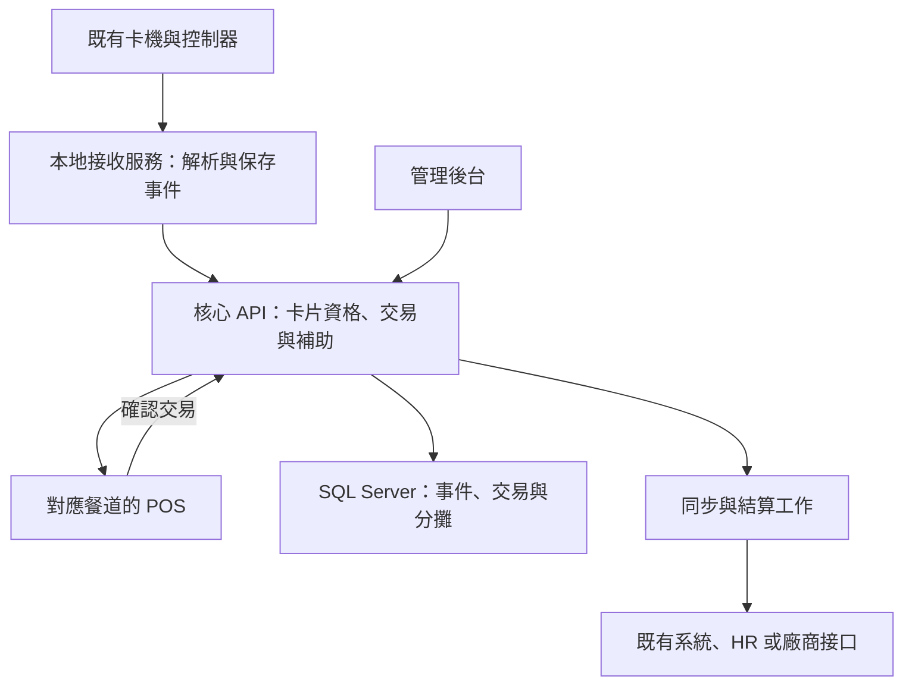

# 緯創康寧台中廠：點餐、RFID 刷卡與餐費整合深度分析

分析日期：2026-11-06（台灣時間）  
用途：內部評估、需求訪談、RA／SA 範圍收斂與設備驗證規劃。

## 1. 判斷與建議

本案可採用既有 .NET 與 SQL Server 技術實作。依目前提供的資料，專案的主體是「既有餐卡設備整合、用餐資格判斷、POS 金額確認、餐補分攤及對帳」。是否再加入菜單、品項、數量、備餐、取餐等完整點餐功能，仍需客戶確認。

目前可以分析既有功能與程式缺口，但尚不足以宣告硬體介接完成，也不足以直接承諾正式交易上線日期。建議先完成一種設備、一個餐道、一台 POS 的完整交易驗證，再擴充設備種類與後台功能。

最需要優先處理的事項：

1. 確定卡機提供的是即時刷卡事件，或事後下載紀錄，以及是否需要查詢命令、ACK、心跳或原廠 SDK。
2. 確保每筆刷卡資料只送到正確餐道，並且與當筆消費建立明確關聯。
3. 確定刷卡、確認交易、補助占用、員工自付及廠商結算的責任與時間點。
4. 防止設備重傳、API 重送、多人同時使用與斷線補傳產生重複計費。
5. 以原系統實際資料及人工確認的案例，核對餐別、跨日、補助、取消與報表規則。

## 2. 本次資料與證據邊界

| 來源 | 已完成的檢視 | 可支持的判斷 | 限制 |
|---|---|---|---|
| `系統規劃資料1021_new.pdf`，7 頁 | 全文擷取，另外檢視第 2、3 頁圖像 | 規劃中的卡機、POS、API、資料庫與後台關係；功能範圍；初估時程 | 屬規劃文件，無法證明功能已實作或驗收 |
| `台中康寧餐費系統介面.pptx`，42 頁 | 檢視各頁主要介面截圖 | 舊版功能、餐別、設備管理、補登、取消恢復與報表樣式 | 截圖不能證明後端演算法或設備實際狀態 |
| `1.用餐管理系統.zip` | 檔案清單檢視 | 包含 EXE、PBD 及 PB 12.5 執行元件 | 在此壓縮檔中未找到 PBL、SRW 等可維護原始碼 |
| `2.用餐感應接收程式-.zip` | 檔案清單檢視 | 包含舊版 RTMC EXE、PBD 及執行元件 | 在此壓縮檔中未找到接收協定原始碼 |
| `3.C#.rar` | 排除快取、編譯產物與發布目錄後，檢視核心原始碼、README、測試工具 | 可核對 C# 接收器的實作範圍與缺口 | 未執行程式、未連線現場設備、未執行其測試工具 |
| Dining 與 POS 的 TableSchema Excel | 檢視全部表結構，重點比對核心業務欄位 | 文件列有 Dining 30 張、POS 9 張表；卡片、員工、時段、金額及同步欄位 | 這是文件中的結構，未以運作中 DB 驗證型態、索引、約束與資料 |
| 兩份「註解生成語法.sql」 | 靜態檢視 | 內容為資料表／欄位 Extended Properties 註解 | 不是完整建庫 DDL，不能據此重建原資料庫 |
| `.bak`、`.mdf`、`.ldf` | 確認提供的檔案存在 | 有資料庫備份或資料檔可供後續隔離環境驗證 | 本次未還原、附加或修改資料庫，未驗證備份可還原性 |

本次沒有修改原始專案、執行 SQL 異動、操作原設備或測試扣款。以下以「已確認」「推論」「建議」「待確認」區分證據強度。資料字典中的中文註解、PK／FK 描述與代碼意義，仍需原始程式及實際資料交叉驗證。

## 3. 需求範圍應先分清楚

| 模式 | 使用流程 | 核心資料 | 本次資料的支持程度 |
|---|---|---|---|
| 刷卡用餐紀錄 | 刷卡，依餐別登記與計算既定費用 | 員工、卡號、時間、餐道、餐別與費用 | 舊介面與結構文件有支持 |
| POS 金額消費 | 刷卡辨識，確認金額，產生交易與分攤 | 上述資料加消費總額、交易狀態、分攤結果 | 規劃 PDF 明確提到選擇消費金額與回傳交易 |
| 完整品項點餐 | 選菜、數量、客製選項、刷卡、備餐與取餐 | 菜單、訂單主明細、供應量、廚房及取餐狀態 | 本次提供的來源中尚未找到完整實作證據 |

第一期建議以客戶已確認的「刷卡辨識＋金額交易＋餐補對帳」為基準。若客戶要求第三種模式，應另列菜單維護、品項與單價、訂購截止、供應數量、訂單修改、未取餐及出餐介接，不應只增加一個金額欄位就視為完成點餐。

## 4. 舊系統呈現的業務內容

### 4.1 基本資料與卡片

截圖可見部門資料、工作地點、員工資料、正式與臨時卡管理、臨時卡登錄、廢卡、卡號上傳／銷碼、感應機重新設碼及員工編號變更。這表示既有系統可能同時管理「中央卡片資料」與「設備端有效卡名單」，不能只完成中央 DB 更新就認定卡片異動生效。

對掛失、離職、卡片換發及臨時借卡，應分別記錄申請時間、中央生效時間、設備同步時間及失敗原因。歷史消費應保存當時的員工與卡片關係，避免卡片回收重發後，把舊交易歸給新持卡人。

### 4.2 餐別與跨午夜

介面第 4 頁顯示四個時段：早餐 04:29–09:00、午餐 10:29–13:40、點心 16:29–19:10、晚餐 21:59–01:30。這些是畫面中的設定範例，需確認是否仍適用。

晚餐跨午夜，應分開保存「設備刷卡時間」「伺服器接收時間」「營業歸屬日」「補登時間」。例如 11/07 00:30 的紀錄可能歸屬 11/06 晚餐，實際規則需客戶認可。不可只用接收當天日期或單純 `開始時間 <= 現在 <= 結束時間` 判斷。

另須確認時間邊界是否含端點、非餐期是否拒絕、設備時間誤差容忍範圍，以及補傳舊紀錄採哪個時區與歸屬日。

### 4.3 費用與補助

設備設定及餐道明細畫面可見公司支付／公司補助、DL 補助及員工自付等欄位。資料字典則將部分 `amount1/2/3`、`amt1/2/3` 解釋為公司補助、員工自付及外包／其他費用。兩者無法直接建立可靠的一對一對應。

這是實作前必須解決的語意差異。應由客戶提供正式、約聘、DL、無補助、臨時卡、跨餐道與取消案例，各列原價、各方分攤、員工自付與廠商應收，再與原 DB 紀錄及報表逐筆核對。

若第一期只有三個付款來源，且沒有其他費用或折扣，可採下列檢核式作為待確認規則：

`交易總額 = 公司負擔 + DL 補助 + 員工自付`

欄位對應、補助上限、可否跨餐道使用、同餐次數與退款後補助恢復規則，都不能由欄位名稱自行推定。

### 4.4 補登、取消與對帳

舊畫面有原始感應紀錄、異常感應紀錄、無工號紀錄、員工用餐補登、用餐次數異常、取消／恢復、金額匯出及多種日／期間／餐道統計。

新系統應讓補登與正常交易經過相同的資格與計費檢查，另外保存補登原因、原始證據、操作者與審核紀錄。取消與恢復需有清楚狀態及反向金額紀錄，不能直接刪除原交易後失去追溯能力。已完成薪資或廠商結算的紀錄，應走調整流程。

## 5. 現有 C# 程式的實際完成程度

原始碼位置為壓縮檔內 `3.C#/_RTMC/`。主程式目標為 `.NET 8 Windows Forms`。

| 能力 | 靜態檢視結果 | 證據 |
|---|---|---|
| SQL 連線測試 | 已實作 | `SqlRepository.cs:24–32` |
| 載入啟用設備 | 已實作，讀取 `time_recording_set`，條件 `recv='Y'` | `SqlRepository.cs:35–64` |
| 每台設備 TCP 主動連線 | 已實作 | `DeviceReceiver.cs:37–65` |
| 連線逾時與失敗重連 | 已實作 | `DeviceReceiver.cs:43–45、68–88` |
| 原始資料 HEX／ASCII 顯示及檔案保存 | 已實作 | `DeviceReceiver.cs:55–65、94–109` |
| RS232 | 本版未實作 | `DeviceReceiver.cs:31–34` |
| 主動下載紀錄、設備查詢命令、ACK、心跳 | 核心程式未看到實作 | 接收迴圈只有讀取資料，未見設備寫入命令 |
| 封包分框、checksum、BF-Mini／DM-760 解碼 | 未實作 | `README.md:16–24`、`DeviceReceiver.cs` |
| 卡號轉員工、資格判斷與餐別判斷 | 未實作 | 接收事件目前僅顯示原始資料 |
| 交易／用餐紀錄寫入 | 未實作 | `SqlRepository.cs` 目前只有查詢；`MainForm.cs:188–191` 只顯示接收內容 |
| `EnableDatabaseWrites=true` | 不能視為開啟交易寫入 | 此設定目前只宣告與顯示，沒有相應寫入流程 |
| POS API、點餐、餐補占用、對帳 | 本次核心來源中未看到 | 此專案屬接收器，非完整後端與 POS |

`ReceiverSmokeTest` 工具連線指定設備並等待 15 秒，以是否收到任何資料作為結果。此工具本次沒有執行。即使它回報成功，也只代表收到位元組，不能證明解出正確卡號、產生正確交易或完成金額核對。

### 接收器仍需補強的工程事項

1. **TCP 資料分框。** 目前每次 `ReadAsync` 的結果就產生一個 `RawPacket`。TCP 讀取結果可能是一筆資料的一部分，也可能包含多筆資料；需依協定累積緩衝、驗證長度／結尾、處理分割與合併。Microsoft 的 `NetworkStream.ReadAsync` 文件說明其回傳目前讀到的位元組數，不能據此推定完整業務訊息。[W1]
2. **通訊方向。** 目前為 TCP Client 被動等待資料。若設備要求主機送出查詢或初始化命令，單純連上 TCP 也不會得到刷卡紀錄。
3. **存活判斷。** 現有逾時主要作用於連線建立。連上後若沒有新資料，沒有另見協定心跳與應用層閒置監測。需區分「沒人刷卡」與「設備故障」。
4. **保存與重送。** 文字 raw log 可協助診斷，但尚未構成具有待處理狀態、確認點與重試機制的交易佇列。磁碟滿或檔案寫入失敗也會影響目前接收迴圈。
5. **設備獨占。** 舊接收器與新接收器是否能同時連線、下載是否會清除記錄或推進游標，尚未確認。現場驗證須先釐清，不宜直接並行接上正式設備。
6. **設定單位。** 文件將 `overtime` 註記為秒，但 C# 直接指定到 `TimeoutMilliseconds`，而舊畫面顯示 4000。應查原規格與現場設定，避免秒／毫秒錯誤；目前不能直接判定哪一方正確。
7. **執行形式。** 正式長時間運作可將接收核心拆成背景服務，WinForms 保留為診斷介面，避免依賴人工登入與視窗開啟。

## 6. RFID 與設備整合的待確認內容

RFID 只描述感應技術，無法單憑此名稱確定實際介接方法。應分開確認卡片、讀卡頭、控制器、接收主機與 POS。

| 項目 | 需要取得的具體資料 | 對本案的影響 |
|---|---|---|
| 卡片 | 原廠、型號、頻率、讀取的區域／資料格式、是否需金鑰 | 決定能否沿用既有員工卡及讀卡器 |
| 卡號語意 | 晶片 UID、應用卡號、門禁控制器轉換碼或其他編碼 | 決定中央與 POS 卡號如何比對 |
| 讀卡機／控制器 | BF-Mini、DM-760 的確切廠牌、硬體版本與韌體 | 同名型號不足以確認協定與能力 |
| 通訊 | TCP Client／Server、RS232、USB、SDK、輪詢或主動推送 | 決定接收服務與部署方式 |
| 即時能力 | 事件延遲、來源設備識別、序號、是否有即時推送 | 決定能否支援現場即時確認 |
| 記錄下載 | 游標、ACK、重傳、容量、刪除或覆寫條件 | 決定斷線補傳與漏單風險 |
| 卡片管理 | 有效卡下載、銷碼、全量重設、設備端黑名單 | 決定掛失與離職實際生效時間 |
| 交易回應 | 是否能回傳准用／拒絕、金額、蜂鳴或顯示內容 | 決定刷卡機提示與 POS 提示的責任 |
| 加解密主機 | 實體設備或邏輯服務、接口、資料格式、金鑰與憑證管理責任 | 決定第三方介接、採購與維運範圍 |

卡號應保留原始位元組或原始文字，以及經規則轉換後的識別值，記錄進位、位元組順序與轉換版本。不得未確認就轉成整數、截斷前導零或只取末幾碼。

若實際卡片屬 MIFARE 系列，NXP 文件列有 4／7／10-byte UID，以及隨機與非唯一識別碼情形。這支持「先確認卡片與卡號性質，再決定識別方式」的設計原則，並不代表本案已確認使用 MIFARE。[W2]

在安全設計上，建議把卡號視為身分查找依據，再由受信任設備、服務與中央規則授權交易。若客戶要求防偽卡或高強度認證，需另外驗證卡片的密碼學認證能力及金鑰管理，不能以「有 HTTPS」推定卡片端已防偽。

## 7. 建議系統架構

採用 ASP.NET Core 後台與 API、SQL Server，以及部署在可到達卡機網段的本地設備接收服務。POS 前台可依現場作業系統與供應商介面選擇網頁或原生程式。

圖中「同步與結算」屬建議邊界，是否需要各外部接口仍待確認。加解密主機應在其實際責任釐清後，加入對應連線段。

### 即時資料與批次資料應有各自用途

- 即時路徑：刷卡事件、對應 POS、取得資格、選擇／確認金額、提交交易、回傳結果。
- 批次／重試路徑：員工主檔、設備卡名單、舊紀錄補傳、報表匯出、廠商結算與失敗重試。

若卡機只有排程下載歷史紀錄，仍可用於用餐統計，是否能達到即時 POS 體驗則須量測與驗證。若客戶要求刷卡後立刻顯示身分，應優先尋找原廠即時事件介面；若現有設備沒有此能力，再評估近端讀卡橋接或增設讀卡器。

## 8. 刷卡如何與正確交易配對

多餐道最大的錯誤風險，是把「系統最後一筆刷卡」當成所有 POS 共用的身分來源。建議設計如下：

1. 為每個廠區、餐道、Reader、控制器與 POS 建立明確對應與設備身分。
2. 接收服務保存原始事件，建立持久的 `SwipeEventId`。若設備有可靠序號，保留來源序號及其重置規則。
3. 中央服務只允許對應的 POS 取得並原子領取該事件。領取有期限，且不得被其他 POS 重複使用。
4. 取得員工、卡片有效期間與可用資格，顯示足以讓現場確認的資料。
5. POS 建立一筆消費草稿。處理期間的新刷卡應排隊或提示等待，不得直接覆蓋目前消費者。
6. 使用者或操作人員確認金額後，以固定 `ClientTransactionId` 提交該筆草稿。重試沿用同一 ID。
7. API 核對 POS 身分、事件領取關係、狀態、金額與補助，原子提交後才回傳成功。
8. 完成、取消或逾時後，清除畫面上的當事人資料，再進入下一筆。

若客戶採「先選餐、最後刷卡」流程，也應將刷卡事件綁定到已建立的消費草稿。兩種操作順序均可設計，需先選定現場操作規則。

`SwipeEventId`、`ClientTransactionId` 與網路請求 ID 是不同用途。卡號加時間只能作為輔助檢查，不能保證唯一。若設備缺少可靠事件序號，需透過持久接收日誌與協定確認點設計去重；若重傳與合法再次刷卡無法區分，應列為協定限制及人工核對情境。

## 9. 交易可靠性與帳務規則

### 9.1 三種重複要分開處理

| 重複種類 | 例子 | 建議處理 |
|---|---|---|
| 設備重傳 | 已下載的同一筆刷卡又送一次 | 依穩定的來源事件識別碼去重，保留接收紀錄 |
| 人員再次刷卡 | 員工短時間重刷，或另買一份 | 依明確業務規則判斷，不直接當成通訊重傳 |
| POS／API 重送 | DB 已成功，回應中斷，POS 重試 | 相同交易 ID 回傳原結果，不增加交易與金額 |

Microsoft 的 Idempotent Consumer 模式建議使用穩定識別碼、資料庫唯一性約束，以及將去重標記與業務寫入置於同一交易，避免併發與中斷產生重複作用。[W3]

### 9.2 交易提交

在同一 SQL 資料庫內，建議同一個交易範圍包含：交易唯一識別、消費主檔、分攤明細、補助占用／扣減、事件消耗狀態與待同步事件。需以唯一約束與適當鎖定或版本控管，防止同一人同時在兩個餐道占用同一份補助。

相同交易 ID、相同內容的重試回傳原結果；相同 ID 卻改了金額、卡片或餐道，應回傳衝突，不可當成同筆成功。查詢到資格不代表補助已保留，正式提交時仍應再次確認。

若須通知舊系統或第三方，交易與待通知資料可先一起寫入 Outbox，再由背景工作重試。接收端仍需去重。AWS 的 Transactional Outbox 說明此方式可處理「資料已寫入但通知失敗」的雙重寫入一致性問題。[W4]

若涉及外部支付、儲值帳戶或實際扣薪，不可把上述單一 DB 交易視為跨系統原子保證。必須另定外部交易 ID、查單、沖正、失敗補償及最終對帳程序。

### 9.3 狀態與成功提示

建議消費狀態包含草稿、待確認、已提交、已取消及已沖正；傳輸狀態另外記錄待同步、同步中、已同步與需人工處理。POS 回應逾時時，畫面顯示「結果待確認」，並以原交易 ID 查詢，不應立即重新建立另一筆交易。

設備蜂鳴、讀到卡號或 API 收到請求，都不能單獨作為計費成功的證據。成功提示應由負責正式交易的服務確認後發出，並明定 POS、卡機與收據的顯示責任。

## 10. 離線策略

目前 POS 結構文件中的 `data_load` 與本地員工資料，支持過去可能存在上傳旗標與本地資料設計的推論；無法據此證明完整離線交易機制已可重用。

| 策略 | 效果 | 適用條件 |
|---|---|---|
| 中央不可用時停止電子交易 | 可避免離線額度衝突，但會影響供餐 | 客戶接受人工備援與事後補登 |
| 廠內交易主機維持服務 | 外網中斷時廠內仍可授權，之後同步 | 可部署並維運廠內服務，且廠內網路正常 |
| 各 POS 離線暫存交易 | 可繼續作業，但可能遇到跨機補助重複使用 | 客戶接受限額、風險歸屬及補傳衝突規則 |

建議先確認廠內網路與主機架構。如果要求斷外網仍可用，可優先評估廠內集中授權。若要求每台 POS 離線使用，必須另列額度分配、快取有效期、卡片撤銷延遲、離線儲存保護、重啟復原與對帳補償；離線同時使用同一份中央補助的風險，不能只靠增加本機暫存表解決。

## 11. 資料模型與移轉風險

### 11.1 既有資料來源對應

| 業務 | Dining 文件中的來源 | POS 文件中的來源 | 驗證重點 |
|---|---|---|---|
| 員工 | `employee`、`depart`、`jobplace` | `employ` | 主檔權威來源、員工類別與部門代碼 |
| 正式卡 | `tcardno`、`employee.cardno` | `employ.cardnu` | 哪個欄位為權威、是否保留換卡歷程 |
| 臨時卡 | `tempcardno`、`tempcardno_set` | 需確認同步方式 | 借用期間、廢卡及歸還 |
| 補助資格 | `subsidy_period`、員工類別、時段／設備設定 | `employ.clsno*`、POS `sysset` | 規則優先順序與生效版本 |
| 原始用餐紀錄 | `time_recording` | `saloon_records` | 同一筆如何識別、是否兩邊均計算費用 |
| 取消 | `time_recording_cancel`、`cancel_sno` | `cancel_sno` | 關聯到哪個來源、恢復與已結算處理 |
| 設備 | `time_recording_set`、`time_recording_cardno` | `mnbr` 等欄位 | 設備、餐道與 POS 是否一對一 |
| 命令／日誌 | `lcc`、`m_*` 等 | 需確認 | `lcc` 可能含命令工作；`m_*` 用途不能只依名稱斷定 |

### 11.2 已看到的文件差異

| 欄位／議題 | 文件呈現 | 影響與建議 |
|---|---|---|
| 卡號長度 | Dining 多為 13；POS 卡號多為 10 | 不可直接縮短欄位。先核對實際編碼、前導零及超長資料 |
| 員工編號 | Dining 13；POS 10 | 以明確對照與資料檢核處理，避免轉存截斷 |
| 姓名 | Dining `nvarchar(50)`；POS `nvarchar(10)` | 新介面與資料結構需支援較長姓名 |
| 部門代碼 | Dining 10；POS 2 | 先確認同碼是否同義，避免錯誤合併 |
| 卡片有效日 | 正式卡 `varchar(8)`；臨時卡 `varchar(10)`；POS 日期型態 | 移轉時保留來源值、驗證格式，再轉為一致日期型態 |
| 用餐與歸屬日 | 有 `carddate`、`rdate`、`ndate` 等 | 需以跨日案例逐一確認語意與報表用法 |
| 費用欄位 | 兩邊有不同命名及中文說明 | 由人工核准案例確認分攤，不硬套中文註解 |
| `m_*` | 文件標為 Mirror，但欄位不一定與主表完全相同 | 不可直接視為即時鏡像、歷程或未使用表 |
| `lcc` | 有 `cmd`、`data`、`cmdlv`、`errorcount` | 可能涉及設備命令與重試，應查原程式使用方式 |
| PK／FK、唯一性 | 文件有文字描述 | 仍需實際 DB 查索引、約束、孤兒與重複資料 |

### 11.3 建議新增的邏輯實體

新模型可先以最少必要實體實作：員工與卡片指派歷程、設備與餐道對應、原始刷卡事件、消費交易與分攤、補助規則與使用紀錄、取消／沖正、同步工作及稽核。名稱與是否合表可依實際 SA 決定。

只有在完整品項點餐確認納入後，再增加菜單、訂單主明細、供應量與出餐狀態。原始刷卡事件應與可計費的消費交易分開，避免每收到一次資料就直接產生一次費用。

## 12. 建議 API 契約

以下為設計提案，不是本次找到的現有 API。

| 用途 | 必要輸入／輸出 | 契約重點 |
|---|---|---|
| 接收刷卡事件 | 來源設備、穩定事件 ID、原始與正規卡號、設備及接收時間 | 設備身分驗證、版本、去重、來源可追溯 |
| POS 取得／領取事件 | POS 身分、餐道、事件 ID | 只能取授權餐道、原子領取、有效期 |
| 查用餐資格／報價 | 事件或員工參照、金額／品項、餐道 | 回傳餐別、資格、分攤及規則版本，不代表已扣款 |
| 確認交易 | 固定交易 ID、事件／草稿參照、確認內容 | 伺服器重算、併發保護、同 ID 重試 |
| 查交易結果 | POS 範圍與原交易 ID | 供逾時、斷線恢復時查單 |
| 取消／沖正 | 原交易 ID、原因、授權操作者、操作 ID | 狀態限制、分攤回補、結算後處理 |
| 員工／卡片異動同步 | 版本或游標、生效期間、撤銷狀態 | 失敗重送、對帳、全量修復 |
| 結算與匯出 | 結算區間、廠商／餐道、結算批號 | 同批次不得重複入帳、保留調整與核對紀錄 |

金額、員工類別、補助資格與最終分攤由服務端決定。POS 所送欄位必須驗證，不能以畫面顯示金額作為唯一計算依據。

## 13. 開發與第三方責任範圍

| 範圍 | 建議交付 | 需要客戶／廠商提供 |
|---|---|---|
| 設備介接 | 協定轉接、原始事件保存、重連、異常與補傳 | 協定／SDK、設備與韌體、測試卡、支援窗口 |
| 卡片與資格 | 員工卡對照、有效期、臨時卡、掛失與補助 | HR／門禁資料權威來源、業務規則 |
| POS | 身分呈現、金額或選餐、確認、查單、取消 | POS 型號、OS、供應商 API／SDK、周邊設備 |
| 交易核心 | 去重、交易狀態、補助分攤、取消沖正 | 計費與同餐／跨餐道規則、人工核准案例 |
| 後台 | 員工／卡片、設備、補登、權限與稽核 | 使用者角色、核准流程、操作責任 |
| 報表結算 | 日／期間／員工／餐道、分攤與匯出 | 報表清單、結算對象、扣薪或請款格式 |
| 移轉與維運 | 資料盤點、試轉、對帳、監控與切換 | 備份、測試環境、窗口與上線安排 |
| 完整品項點餐（待定） | 菜單、訂單明細、數量、備餐與取餐 | 菜單規則、廚房／廠商介面、供餐作業流程 |

舊版執行檔可供行為核對，若需要修改舊系統，還需取得可維護原始碼及合法使用／修改授權的明確範圍。此項應列交接與合約事項，不能以持有執行檔推定已具備完整開發條件。

## 14. 驗證與交付順序

規劃 PDF 提出 2026/11 至 2027/03 的初估排程，並已註明工期、人力與第三方介接待確認。本次沒有重新估算人天；建議以以下完成條件收斂後，再建立正式 WBS 與報價。

| 階段 | 要完成的工作 | 通過條件 |
|---|---|---|
| A. 範圍與證據盤點 | 選定交易模式、設備清單、系統責任、卡號與計費案例 | 一個完整現場流程與範圍獲確認，協定／SDK 到位 |
| B. 設備實證 | 每型設備捕捉正常、連刷、斷線、重送與補傳資料 | 可逐筆解析、來源可辨識，已知設備命令與時間意義 |
| C. 單餐道交易 | 一台設備、一台 POS、資格、金額、正式提交與查單 | 正常、逾時重試、取消均得到正確且唯一的交易 |
| D. 多餐道與業務規則 | 同時刷卡、跨餐道補助、臨時卡、跨午夜、補登 | 不串人、不重複補助，所有分攤可對帳 |
| E. 後台與移轉 | 後台、報表、HR／舊系統同步、資料試轉 | 主檔、交易與報表完成明細及彙總核對 |
| F. 試營運與切換 | 觀測模式、故障演練、交接、正式切換 | 連續涵蓋完整餐期且無未解決帳差，切換與回復程序完成 |

觀測模式應只記錄與比較，不產生第二份正式計費。若設備只容許單一接收者，需用廠商支援方式取得鏡像資料或在隔離設備測試，不可直接同時啟動兩個接收程式。

### 建議驗收案例

| 編號 | 情境 | 核心期待 |
|---|---|---|
| T01 | 有效正式卡完成一筆消費 | 身分、餐道、餐別、分攤與交易 ID 正確 |
| T02 | 過期、掛失、廢止或不明卡 | 依規則拒絕並留原因，不產生錯誤計費 |
| T03 | 臨時卡借用起迄與歸還後重發 | 當次使用者正確，歷史交易不改歸屬 |
| T04 | A、B 餐道同時刷不同員工 | 各 POS 只收到對應事件，不串人 |
| T05 | 同餐道連續刷兩人，第一筆尚未完成 | 新事件不覆蓋第一筆交易對象 |
| T06 | 同一來源事件重傳多次 | 保留接收證據，只形成一筆有效事件作用 |
| T07 | 同一交易 ID 重送及同 ID 不同內容 | 相同內容回原結果；不同內容回衝突 |
| T08 | DB 提交成功後回應中斷 | POS 查到原成功結果，不重新計費 |
| T09 | 同一員工兩餐道同時使用補助 | 補助占用原子控制，結果符合業務規則 |
| T10 | 刷卡後取消、確認前逾時、換人操作 | 沒有未完成交易誤計費或身分殘留 |
| T11 | 23:59、00:00、01:30 與時段邊界 | 餐別與營業歸屬日符合核准案例 |
| T12 | 非用餐時段與時鐘偏差 | 依規則處理，保存設備與接收時間 |
| T13 | TCP 資料被拆開或多筆合在一次讀取 | 解析筆數及欄位正確，不因讀取次數計費 |
| T14 | 接收器重啟、網路中斷與設備補傳 | 已保存資料可恢復，無漏單及重複作用 |
| T15 | 人員離職／掛失，設備尚未同步 | 中央、設備與離線策略的生效時間可查 |
| T16 | 補登、取消、恢復及已結算交易調整 | 保留原始證據，分攤及結算一致 |
| T17 | 超長卡號、前導零、較長姓名與員編 | 無截斷、誤轉碼或錯誤對照 |
| T18 | 員工自付、公司與 DL 分攤、廠商應收 | 明細可加總到日結、期間及匯出結果 |
| T19 | 外網斷線、中央服務中斷、DB 不可用 | 依已選策略停止或降級，畫面不誤報成功 |
| T20 | 本地磁碟滿、日誌失敗、待補傳累積 | 可告警並依策略處理，能識別待人工核對紀錄 |

效能指標應以現場餐期量測後制定。可先討論「線上刷卡到 POS 顯示 p95 不超過 1 秒、確認到結果 p95 不超過 2 秒」等候選目標，這些不是本次量測結果或已承諾 SLA。應另外定義測量起點、並行餐道數、尖峰量、硬體、網路條件與允許失敗率。

## 15. 客戶會議應確認的十項決策

1. 系統屬刷卡登記、POS 金額消費，或完整品項點餐？第一期必須交付到哪一種？
2. 客戶希望先選餐再刷卡，或先刷卡再確認金額？由員工自助還是工作人員操作？
3. BF-Mini、DM-760 的確切原廠與版本、台數、接線方式、協定及 SDK 是否可取得？
4. 每一刷卡機對應哪一個 POS／餐道？是否允許多人共用一讀卡機或跨餐道消費？
5. 卡號實際取自哪裡？員工主檔、正式卡、臨時卡、掛失與離職資料由哪套系統負責？
6. 公司負擔、DL 補助與員工自付如何計算？同餐可否多次或跨餐道用補助？
7. 員工自付採薪資扣款、儲值扣款、現場收款或只出報表？由誰完成實際收款？
8. 晚餐跨午夜、補登、取消恢復、已結算調整與訪客費用，規則各是什麼？
9. 外網或中央主機故障時是否必須繼續供餐？可接受哪種人工或離線備援？
10. 「加解密主機」、POS、卡機、既有系統與新後台各由誰提供、修改與維運，最終由誰確認成功及帳務？

## 16. 目前建議採取的下一步

先安排「一台實體設備＋測試卡＋原廠協定＋一台 POS」的小範圍驗證，同時由客戶提供費用分攤與跨日的人工核准案例。驗證完整閉環：刷卡、事件解析、對應 POS、取得資格、確認金額、交易提交、查單、取消及對帳。

這一階段通過後，再把已證實的設備能力與業務規則寫入 RA，作為後續後台開發、多餐道擴充、資料移轉與正式排程的依據。可以並行盤點後台頁面與報表，但核心交易規格應以這個驗證結果收斂。

## 附錄 A：本機來源定位

來源根目錄：`C:\專案資料\緯創-康寧台中廠`。

- `系統規劃資料1021_new.pdf`：第 2、3、5、6、7 頁為整合與功能重點，第 4 頁為初估排程。
- `台中康寧餐費系統介面.pptx`：第 4 頁餐別；第 5 頁設備與費率；第 7–10 頁臨時卡／設碼；第 12–18 頁紀錄、補登、異常與取消恢復；第 19–40 頁報表與對帳。
- `1.用餐管理系統.zip`：`1.Dining/`，舊版執行檔與 PBD。
- `2.用餐感應接收程式-.zip`：`2.RTMC/`，舊版接收器執行檔與 PBD。
- `3.C#.rar`：`3.C#/_RTMC/README.md`、`DeviceReceiver.cs`、`SqlRepository.cs`、`MainForm.cs`、`AppSettings.cs`、`DeviceConfig.cs`、`Program.cs`、`RtmcReceiver.csproj` 與 `tools/ReceiverSmokeTest/Program.cs`。
- `Database/Database/Corning_Dining_TCTableSchema202604280121.xlsx`：上述 Dining 表與欄位。
- `Database/Database/Corning_POS_TCTableSchema202604280121.xlsx`：上述 POS 表與欄位。
- `Database/Database/Corning_Dining_TC註解生成語法.sql`、`Corning_POS_TC註解生成語法.sql`：中文欄位說明參考。

原始資料中的人員、卡號、內網位址與帳密不附於本報告。此次結論以提供的檔案版本為範圍，其他未交付來源可能包含額外功能。

## 附錄 B：技術依據

以下官方資料於 2026-11-06 查閱，僅支持一般技術原則，不代表原廠已確認本案設備相容性。

- [W1] Microsoft，NetworkStream.ReadAsync：<https://learn.microsoft.com/en-us/dotnet/api/system.net.sockets.networkstream.readasync>。支持 TCP 接收端需處理讀取位元組與業務訊息邊界的設計判斷。
- [W2] NXP，AN10927，MIFARE product and handling of UIDs，Rev. 4.1：<https://www.nxp.com/docs/en/application-note/AN10927.pdf>。說明多種 UID 長度與隨機／非唯一識別碼情形。
- [W3] Microsoft，Idempotent Consumer pattern：<https://learn.microsoft.com/en-us/azure/architecture/patterns/idempotent-consumer>。支持穩定去重鍵、原子提交與併發唯一性控制。
- [W4] AWS，Transactional outbox pattern：<https://docs.aws.amazon.com/prescriptive-guidance/latest/cloud-design-patterns/transactional-outbox.html>。支持交易與待通知事件一起保存、另行可靠發送的方式。
