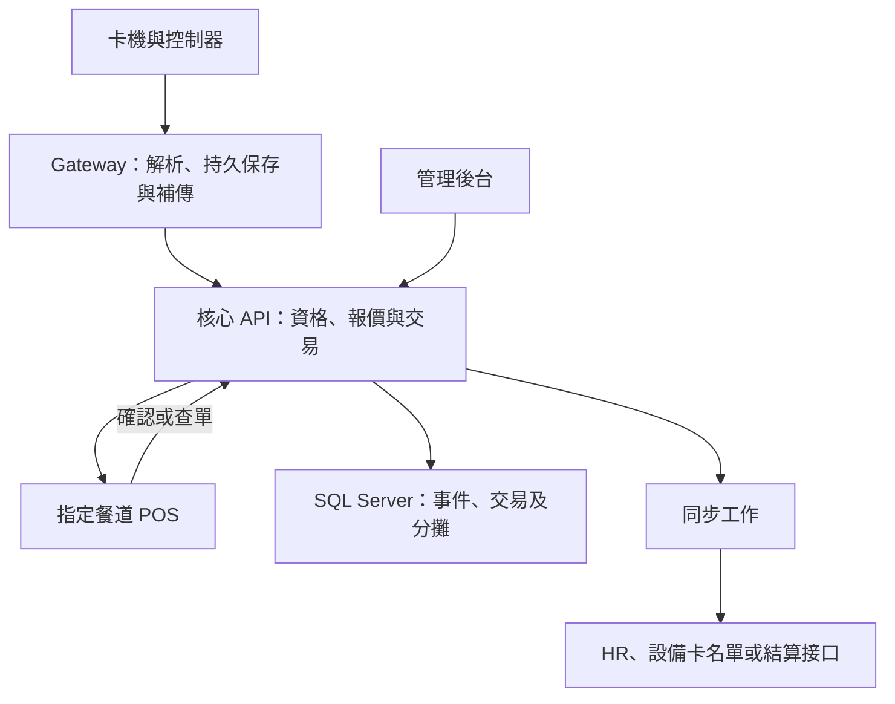
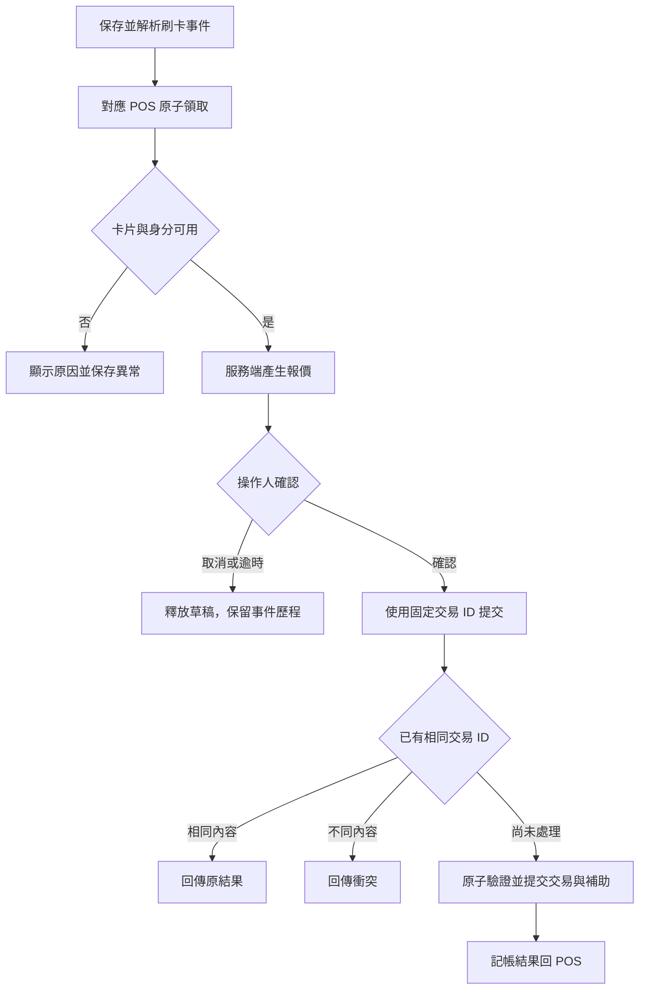
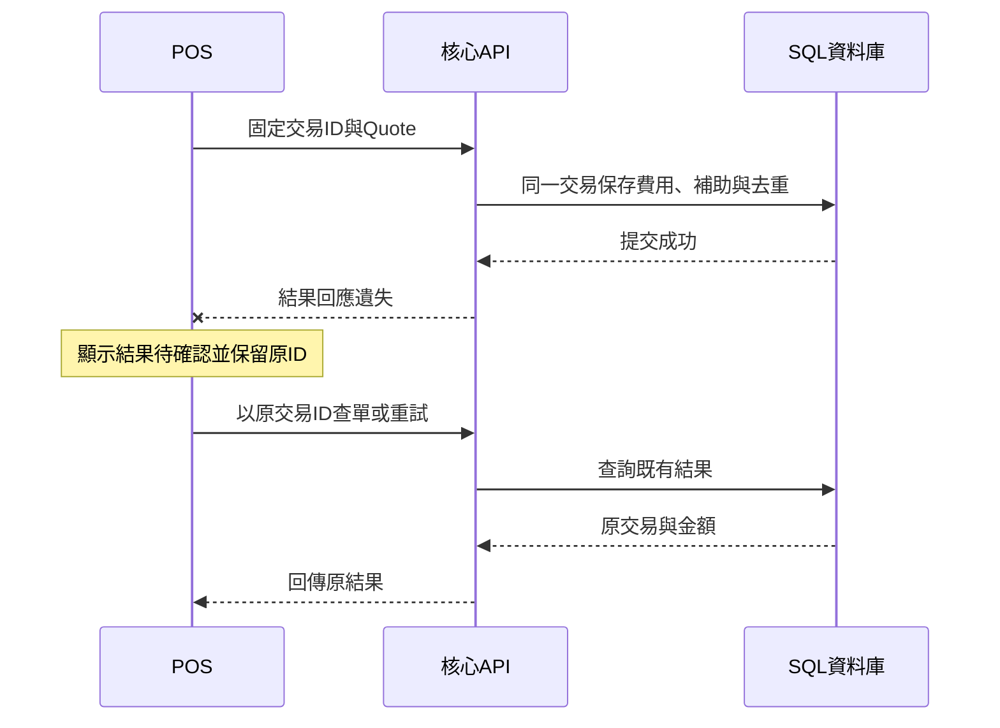
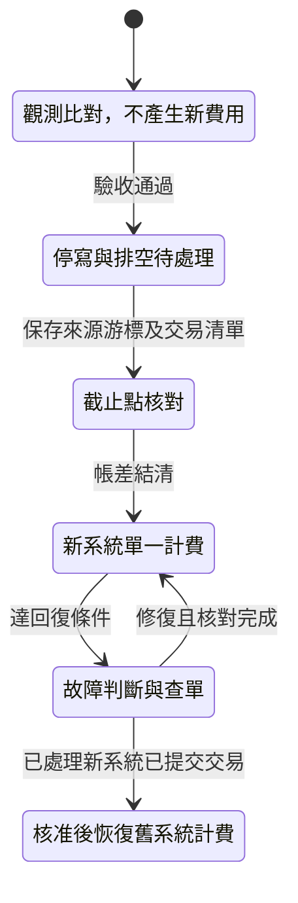

# TC 系統與作業流程圖

版本 v1.0。所有圖為設計草案，與客戶／廠商確認後更新，不表示已有實作。一般金額交易為一期情境，選配點餐另列。

## 1. 系統關係

加解密主機的位置與協定由 Q11 確認，不能將圖中 API 傳輸安全視為已完成卡片端認證。

## 2. 一筆 POS 消費

交易是否提交與補助是否可用由同一提交邊界判斷。新卡事件不能直接取代正在處理的員工。

## 3. 回應遺失與查單

查無結果不代表可以立即換 ID 再送；要區分原請求仍處理中、確定未受理與已提交。處理中重試回適當狀態，經查明後才決定下一步。

## 4. 卡片撤銷與設備生效

| 步驟 | 中央動作 | 設備／整合動作 | 異常處理 |
|---|---|---|---|
| 1 | 保存卡片撤銷及來源版本 | 建立銷碼工作 | 主檔異動與工作一併保存 |
| 2 | 中央授權依新狀態拒絕 | Gateway 依原廠協定下發 | 斷線保留待送，不回報已生效 |
| 3 | 查詢同步狀態 | 確認設備已接受或核對名單 | 記錄中央與設備兩個生效時間 |
| 4 | 檢查較舊來源資料 | 拒絕以舊有效版本覆蓋新撤銷 | 全量修復仍遵守版本與撤銷規則 |

## 5. 正式切換

回復不是單純回復資料庫備份；新系統運行期間的成功、待確認與補傳交易必須先查清。詳見[切換與回復計畫](../4_測試與執行/TC_切換上線與回復計畫.md)。

